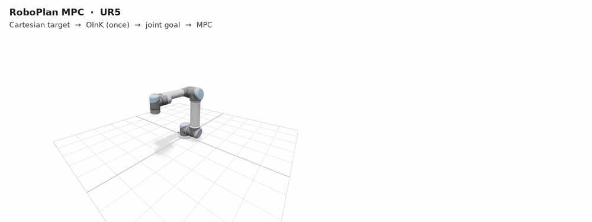
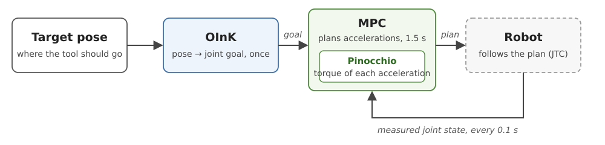

# roboplan_MPC

Joint-space model predictive control (MPC) built on [RoboPlan](https://github.com/open-planning/roboplan), [Pinocchio](https://github.com/stack-of-tasks/pinocchio), and [CasADi](https://web.casadi.org/).



## How it works



1. **OInK** (RoboPlan) converts a target pose into a joint goal, once per target.
2. **The MPC** plans the joint accelerations for the next 1.5 s toward that goal, within the joint position, velocity, acceleration, and torque limits. **Pinocchio** computes the torque each planned acceleration requires (inverse dynamics), which the MPC keeps within the motor limits.
3. **The robot** follows the plan, e.g. through a joint trajectory controller. Every 0.1 s the MPC replans from the measured state.

By default each cycle runs one SQP iteration (CasADi `sqpmethod` with OSQP), warm started from the previous solution: about 2–10 ms per solve. IPOPT is available through `MPCOptions(solver="ipopt")`.

## Build and run

Requires [pixi](https://pixi.sh). RoboPlan, Pinocchio, and CasADi come from conda-forge.

```bash
pixi run build      # configure, build, and install into the pixi environment
pixi run test       # C++ and Python tests
pixi run example    # browser viewer at http://localhost:8080 (--model ur5|franka|dual|so101)
```

## Usage

```python
from roboplan.mpc import MPC, MPCOptions

mpc = MPC(scene, MPCOptions(group_name="arm"))
mpc.setGoal(goal)              # JointConfiguration, e.g. from OInK
trajectory = mpc.solve(state)  # JointTrajectory over the horizon, starting at the measured state
```

The same API is available in C++ (`roboplan::MPC`, `roboplan::MPCOptions`).
